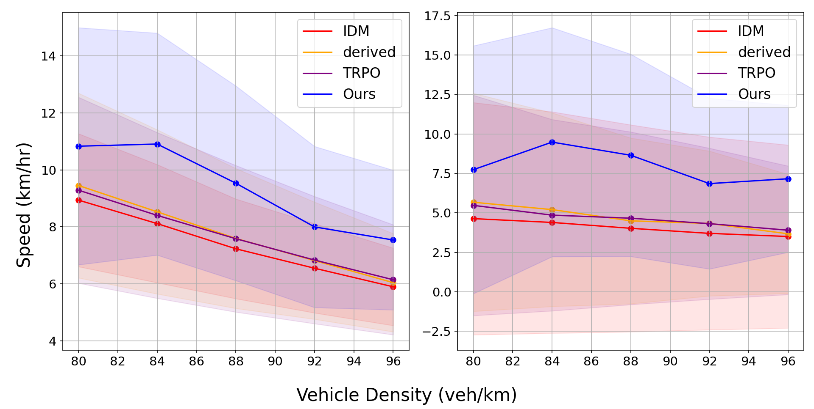
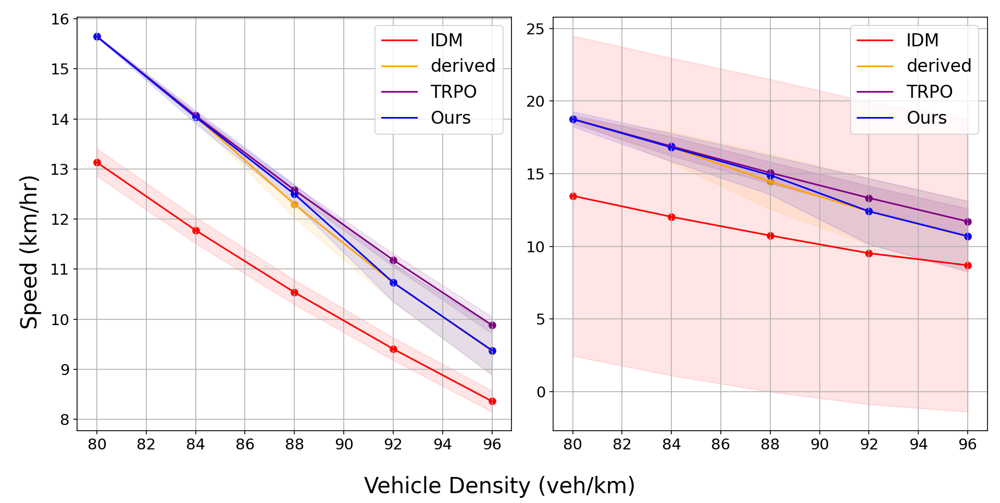
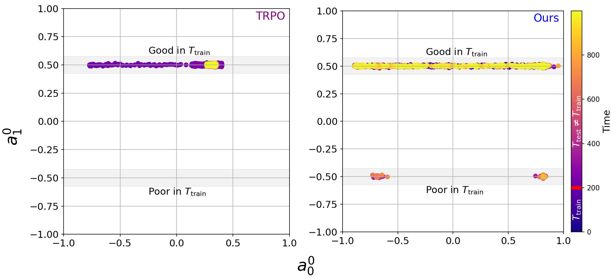

# GPDP for Traffic Fusion

**Gaussian Process Diffusion Policy (GPDP) for Autonomous Vehicles in Mixed Traffic**

A PhD research implementation of the **Stochastic Gaussian Process Diffusion Policy (GPDP)** — an offline reinforcement learning algorithm that combines Gaussian Processes with Diffusion Models to control a single autonomous vehicle (AV) in a mixed-traffic ring road, improving overall traffic flow in congested scenarios.

Simulations are built on [SUMO (Simulation of Urban Mobility)](https://sumo.dlr.de/).

---

## Algorithm Overview

GPDP learns from offline expert demonstrations (no live environment interaction during training). The policy uses:

- **Diffusion model** (VP schedule, 50 forward + 50 denoising steps) to generate actions.
- **Gaussian Process** (Exact GP) to model uncertainty and shape the policy.

At test time, the AV observes a 10-dimensional state (own speed, lane, plus leader/follower/neighbor vehicle kinematics) and outputs a 2-dimensional action (longitudinal acceleration ∈ [−1.5, 1.0] m/s², lateral lane-change command).

---

## Repository Structure

```
GPDP-for-traffic-fusion-2026/
├── main.py                        # Entry point — dataset / training / testing / plotting
├── agents/
│   ├── AV.py                      # AV agent using GPDP controller
│   ├── DerivedAV.py               # Rule-based expert agent
│   ├── IDM.py                     # Intelligent Driver Model baseline
│   ├── RandomAV.py                # Random-action baseline
│   ├── GPs/
│   │   ├── exactGP.py             # Exact GP with RBF kernel
│   │   └── SVGP.py                # Sparse Variational GP
│   └── RLs/
│       ├── GPDP.py                # Main algorithm: GPDP
├── environments/
│   └── double_ring/
│       ├── double_ring.py         # SUMO environment wrapper
│       ├── double_ring.sumocfg.xml
│       ├── double_ring.net.xml
│       ├── double_ring.rou.xml
│       └── double_ring.add.xml
└── utilities/
    ├── dataset_creation.py        # Generate offline RL datasets
    ├── training.py                # Offline and online training loops
    ├── evaluation.py              # Policy evaluation in SUMO
    ├── MLP.py                     # 3-layer MLP (policy & value networks)
    ├── miscellaneous.py           # Path helpers, scaling, encoding
    ├── plot_results.py            # Speed vs. density result plots
    └── plot_actions.py            # Action distribution visualisations
```

---

## Requirements

### Python packages

| Package | Notes |
|---|---|
| `torch` | PyTorch ≥ 1.12 (GPU recommended for GP training) |
| `numpy` | Array operations and dataset storage |
| `matplotlib` | Result and action-distribution plots |
| `traci` | SUMO Python API (bundled with SUMO install) |
| `sumolib` | SUMO utility library (bundled with SUMO install) |

Install Python dependencies:

```bash
pip install torch numpy matplotlib
```

### SUMO

SUMO ≥ 1.19.0 is required. Install from [https://sumo.dlr.de/docs/Downloads.php](https://sumo.dlr.de/docs/Downloads.php) and ensure the `SUMO_HOME` environment variable is set:

```bash
# Linux / macOS
export SUMO_HOME=/usr/share/sumo      # adjust to your install path

# Windows (PowerShell)
$env:SUMO_HOME = "C:\Program Files (x86)\Eclipse\Sumo"
```

---

## Data & Output Paths

Datasets, training records, and evaluation results are stored **outside** the repository.

### Recommended: edit `config.json` once

Fill in `config.json` at the project root **once** — every subsequent command picks it up automatically:

```json
{
    "dataset_path": "/your/data/datasets",
    "train_path":   "/your/data/training_records",
    "eval_path":    "/your/data/evaluation_results"
}
```

After that, all commands work with no extra flags:

```bash
python main.py --task dataset  --dataset_type expert
python main.py --task training --alg GPDP
python main.py --task testing  --alg GPDP --load
```

### Alternative: CLI flags (one-off override)

Pass the flags directly to override `config.json` for a single run:

```bash
python main.py --task dataset \
  --dataset_path /your/data/datasets \
  --train_path   /your/data/training_records \
  --eval_path    /your/data/evaluation_results
```

### Priority order

```
CLI flags  >  config.json  >  hardcoded defaults (miscellaneous.py)
```

The algorithm and environment names are appended automatically, e.g. `train_path: /data` → `/data/GPDP_double_ring_training_records.pth`.

---

## Usage

All tasks are run through `main.py`. Global seed is fixed at `2203`.

### 1. Create an offline dataset

```bash
python main.py --task dataset --env double_ring --dataset_type expert
```

- `--dataset_type`: `expert` (paper default), `human`, `human-expert`, or `human-random`.
- You will be prompted to enter the number of data points (paper uses `1000000`).
- Saves `<dataset_path>_<type>.npz`.

### 2. Train GPDP

```bash
python main.py --task training --alg GPDP --dataset_type expert --gradient_step 200000
```

When prompted, enter `offline` (or `online` for continued environment interaction).

| Argument | Options | Default |
|---|---|---|
| `--alg` | `GPDP` | `GPDP` |
| `--gradient_step` | integer | `200000` |
| `--load` | flag — resume from checkpoint | off |

Training saves a PyTorch checkpoint (`.pth`) to `<training_record_path>`.

### 3. Evaluate a policy

```bash
python main.py --task testing --alg GPDP --dataset_type expert --eval_mode standard --load
```

Evaluates across vehicle densities `[40, 42, 44, 46, 48]` with 10 runs each (1 000 timesteps per run). Use `--render` to open the SUMO GUI.

| `--eval_mode` | Description |
|---|---|
| `standard` | Normal traffic scenario |
| `shifted` | Robustness test — includes "imposter" vehicles with shifted dynamics |

Results are saved to `<evaluation_path>_<dataset_type>_<eval_mode>.npz`.

### 4. Plot speed results

```bash
python main.py --task plot --dataset_type expert --eval_mode standard
```

Produces a **mean vehicle speed vs. traffic density** plot comparing IDM, DerivedAV (Expert), TRPO, and GPDP (Ours).

### 5. Plot action distributions

```bash
python main.py --task plot_action --dataset_type expert --eval_mode standard
```

Produces scatter plots of longitudinal vs. lateral actions, comparing dataset actions, TRPO, and GPDP.

---

## Environment: Double-Ring Road

| Property | Value |
|---|---|
| Topology | 2-lane circular road, 250 m circumference |
| Vehicle count | 40 – 48 (configurable density) |
| Simulation step | 0.1 s |
| AV observation dim | 10 (own speed, lane; leader, follower, lane-neighbour kinematics) |
| Action dim | 2 (acceleration m/s², lane-change) |
| Reward | Speed-based (global average of 5 observed vehicles) |

---

## Agents & Baselines

| Agent | Description |
|---|---|
| **GPDP** (Ours) | GP Diffusion Policy — proposed algorithm |
| **DerivedAV** (Expert) | Rule-based expert: accelerate/decelerate towards target speed |
| **IDM** | Intelligent Driver Model — SUMO default car-following model |
| **RandomAV** | Uniformly random actions — weakest baseline |
| **TRPO** | Trust Region Policy Optimisation — online RL baseline (pre-computed results loaded for plotting) |

---

## Results

Evaluation metric: **mean vehicle speed (km/h)** across 5 traffic density configurations {80, 84, 88, 92, 96} veh/km (corresponding to {40, 42, 44, 46, 48} vehicles on the 500 m double-ring road). All results are averaged over 10 trajectories with 10 random seeds.

### Non-stationary traffic (shifted dynamics)



An imposter vehicle suddenly slows to ~1.8 km/h at t = 200 s, introducing a distribution shift unseen during training.

| Method | Avg all-vehicle speed (km/h) | Avg AV speed (km/h) |
|---|---|---|
| **GPDP (Ours)** | **~8 – 11** | significantly higher |
| DerivedAV (Expert) | lower than GPDP | lower than GPDP |
| IDM | lowest | lowest |
| TRPO | lower than GPDP | lower than GPDP |

- GPDP achieves **~30% higher overall vehicle speed** than baselines under dynamics shift.
- GPDP's AV speed is **~60% higher** than baselines under dynamics shift.
- TRPO, trained under stationary dynamics, degrades significantly when the dynamics shift occurs because its policy stays concentrated in actions that were optimal during training.
- GPDP adapts by shifting probability mass toward actions in the lower diffusion space (a¹ ≈ −0.50), which become beneficial after the shift — enabled by the GP uncertainty estimate increasing Σω when the test observation is far from training data.

### Stationary traffic (standard dynamics)



No dynamics shift; all vehicles follow their normal control algorithms throughout.

| Method | Avg all-vehicle speed (km/h) |
|---|---|
| **GPDP (Ours)** | comparable to DerivedAV |
| DerivedAV (Expert) | best / comparable to GPDP |
| TRPO | competitive at highest density (92 – 96 veh/km) |
| IDM | lowest |

- GPDP matches expert-level (DerivedAV) performance across all density configurations under normal conditions, confirming the behaviour-cloning objective is well satisfied.

### Action distributions (shifted dynamics)



TRPO (left) concentrates actions in the upper region (a¹ ≈ +0.50, good under T_train) and fails to explore after the shift. GPDP (right) shifts mass toward the lower region (a¹ ≈ −0.50) after t = 200 s, recovering performance. Point colour encodes evaluation time; the red marker on the colourbar indicates the dynamics-shift time t = t′.

### Output files

```
<eval_path>_expert_standard.npz   # stationary scenario
<eval_path>_expert_shifted.npz    # non-stationary (dynamics shift) scenario
```

Each `.npz` contains arrays: `accum_reward`, `avg_av_speed`, `avg_all_speed`, `std_av_speed`, `std_all_speed` — one entry per density configuration.

---

## Reproducibility

- Global seed: `2203`
- Evaluation seeds: `2203 + i × 100` for the *i*-th evaluation run
- Dataset creation and training both respect the global seed set in `main.py`
